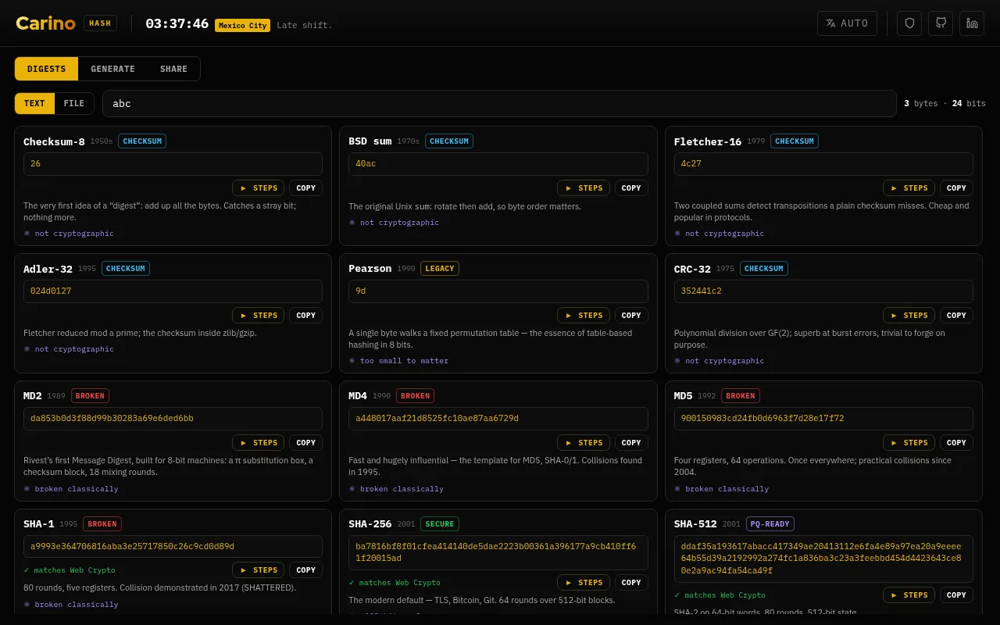

# Carino Hash

The full client-side crypto workbench → **[hash.carino.systems](https://hash.carino.systems)**

A course in seven modules, each addressable by link (`#md`, `#md/stage-2`,
`#md/lab`, `#md/reference`):

| Module | Link | Algorithms |
|---|---|---|
| **Checksums** | `#checksums` | Checksum-8, BSD sum, Fletcher-16, Adler-32, CRC-32 |
| **Legacy hashes** | `#legacy` | Pearson |
| **MD family** | `#md` | MD2, MD4, MD5 |
| **SHA-1 and SHA-2** | `#sha` | SHA-1, SHA-256, SHA-512 |
| **SHA-3** | `#sha3` | SHA3-256, SHA3-512 |
| **Post-quantum** | `#pq` | Lamport one-time signature |
| **Compare** | `#compare` | every algorithm on your input, side by side |

Each module page opens with the step-player lab on that family, then one stage per
algorithm with a **Done** tick, then an at-a-glance table. Progress is ticked by you
and kept in this browser only (`localStorage['hash.<module>']`); the navbar's
Progress menu exports and imports it as a JSON file and resets it.

Drop in a file or type text and watch a hash actually get computed — the padding,
the message schedule, and every one of **SHA-256's 64 rounds**, step by step.
Nothing is uploaded; everything runs in the browser.

Password generation and secret splitting moved to
**[password.carino.systems](https://password.carino.systems)** (its "More control"
panels have the exact length, character sets, entropy maths and *k*-of-*n*
splitting that used to live here). Old links (`#generate`, `#share`, `#recover`)
redirect there.

## Features

- **A course, not a wall of cards** — six family modules plus a Compare lab. Every
  algorithm keeps its era, output size, security badge, a plain-language note, and
  a ⚛ line on its quantum standing (e.g. *~128-bit vs Grover*, *broken classically*).
- **Step-player lab** — each module page opens with an inline player: a legend
  explaining each panel, and a play / step / back / reset stepper (Space plays,
  ← → step) that
  animates the algorithm's real internals — byte-by-byte for the checksums;
  padding, schedule and rounds for the MD/SHA families; the θ·ρ·π·χ·ι sponge
  rounds with the live 5×5 lane state for Keccak/SHA-3.
- **Explained for everyone** — each step shows a friendly "what's happening"
  sentence for non-technical readers, plus an "In math terms" box (the actual
  recurrence / formula) for the mathematically inclined.
- **Large files are opt-in** — above 2 MB nothing is hashed automatically; each
  card shows a notice and a "Compute _X_ now" button so you digest one algorithm
  at a time instead of freezing the tab. (The Steps walkthrough still animates the
  first 64 KB.)
- **15 cards across the history of hashing** —
  *Checksum-8 (1950s), BSD sum (1970s), Fletcher-16 (1979), Adler-32, Pearson,
  CRC-32, MD2 (1989), MD4 (1990), MD5 (1992), SHA-1 (1995), SHA-256, SHA-512
  (2001), SHA3-256, SHA3-512 (2015)*, plus the **Lamport one-time signature** —
  each with era, output size, security badge and a plain-language note.
- **From-scratch, verified** — MD2, MD4, MD5, SHA-1, SHA-256, SHA-512,
  Keccak/SHA-3, CRC-32 and the checksums are implemented from scratch (no
  libraries), checked against known test vectors and **cross-checked against the
  browser's Web Crypto** where an equivalent exists.
- **Post-quantum, as its own card** — the **Lamport one-time signature**, built
  purely on SHA-256, is a card like any other: press ▶ Steps to walk keygen →
  sign → verify → *tamper* (watch verification correctly fail) on the current
  input. Its intro explains why hashing survives quantum attacks (Shor breaks
  RSA/ECC, but a hash only loses a square-root to Grover — so SHA-512/SHA3-512
  stay safe), the same reasoning surfaced on every card's ⚛ line.
- **Print the steps** — the lab has a "🖨 Print steps" button
  that exports that algorithm's *complete* walkthrough as a clean branded PDF:
  intro, digest, and every numbered step with its plain explanation, "In math
  terms" formula, and values.

## Design

Single self-contained `index.html` (inline CSS/JS). Shares the Carino navbar
(`carino-navbar.js` + `carino-clock.js`) and branding with the rest of
carino.systems. No build step, no external runtime dependencies (Google Fonts
are progressive-enhancement only).

## Notes

- Pure-JS hashes (MD5 / SHA-3 / CRC32) are skipped above 8 MB to avoid freezing
  the tab; native Web Crypto SHA-1/256/384/512 run at any size.
- The visualizer animates the first few 512-bit blocks; the digest is always the
  full result.
- Educational only — not a security product. The Lamport demo is a teaching
  illustration of hash-based signatures, not a hardened implementation.

## Licensing

**Mine — GNU Affero General Public License v3.0 or later.** Everything in this
repository *except* the paths listed below. Copyright © 2026 Miguel Carino.
Full terms in [LICENSE](LICENSE).

**Not mine.** The files below are third-party works redistributed here. This
project's licence does not cover them and could not: they are not mine to
relicense. Each keeps its own terms, and each carries its own notice.

| Path | What it is | Licence | Notice |
| --- | --- | --- | --- |
| [`fonts/`](fonts/) | IBM Plex Mono, IBM Plex Sans, Red Hat Display | SIL OFL 1.1 | [`fonts/OFL.txt`](fonts/OFL.txt) |

Those files travel with any fork, mirror or repackaging of this repository, and
their notices must travel with them.
